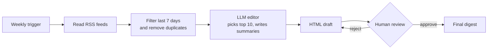

# AI News Digest Agent

A small agent that turns a week of tech news into a short, reviewed digest:
it reads RSS feeds, removes duplicates, lets an LLM pick and summarize the top stories, and waits for a human to approve before anything is sent.



## Background

I first built this as a no-code workflow for a weekly technology bulletin at work. That version:

- scanned 50+ industry and technology sources every Monday morning,
- used an LLM as the editor to classify and summarize articles,
- sent a review draft by email with approve/reject links before the final bulletin went out,
- archived every issue as JSON.

This repository is a minimal Python version of the same idea, using public tech news feeds. It contains none of the original sources, prompts or data.

## Run

```bash
pip install -r requirements.txt

python digest.py --dry-run   # no API key: keeps the 10 newest articles
python digest.py             # Claude picks and summarizes (needs ANTHROPIC_API_KEY)
python digest.py --approve   # after reviewing output/draft.html
```

Sources are in `sources.json`; add or remove feeds there. The model can be changed with the `DIGEST_MODEL` environment variable.

## Design choices

- **Human in the loop:** the LLM only drafts. Nothing is final until a person approves it.
- **Fail soft:** a broken or rate-limited feed is skipped, not fatal.
- **Cheap:** one LLM call per week with titles and short snippets, not full articles.

## Stack

Python (standard library), Anthropic API. The original version used n8n, Gemini and Gmail.
